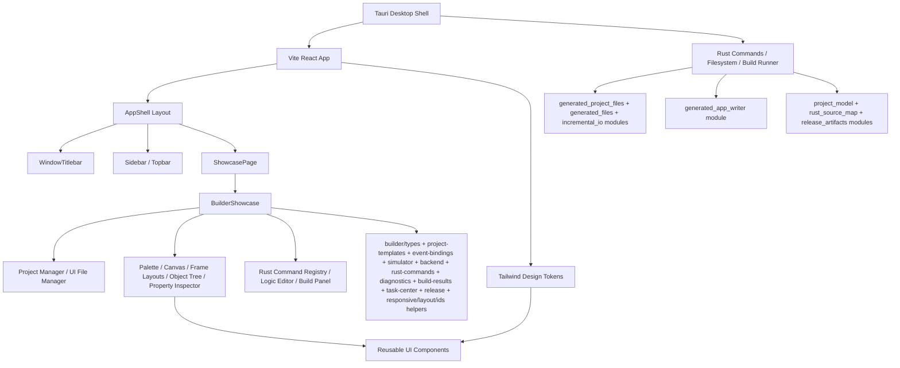

# Nova UI Kit

Nova UI Kit is evolving into Nova UI Editor: a modern desktop UI editor built with Tauri, React, TypeScript, Tailwind CSS, Radix UI, shadcn/ui-style components, and lucide-react.

The project has two goals:

- Provide a Qt Design Studio-like editor so users can create projects, manage UI files, place controls on an empty canvas, edit Rust logic, and build toward a Tauri executable.
- Keep the reusable component primitives available internally for the editor itself.

Repository: https://github.com/sorrowfeng/nova-ui-kit

## Highlights

- Desktop-first UI workbench, not a marketing landing page.
- Tauri v2 desktop shell with custom titlebar and native window controls.
- React + TypeScript frontend powered by Vite.
- Tailwind CSS design tokens with light/dark themes and density modes.
- shadcn/ui-style reusable components in `src/components/ui`.
- Radix UI primitives for accessible dialogs, dropdowns, popovers, tabs, selects, switches, toasts, and tooltips.
- lucide-react icon system.
- Project-based editor with multiple UI files per project, project image assets, empty canvas, canvas size presets, freeform and Frame auto-layout modes, Rust command registration, UI event-to-command binding, generated app scaffolding, build logs, preview, and JSON/React export.
- MIT licensed.

## Interface Editor

The editor is the default first screen. It is designed to work more like a lightweight Qt Designer than a component gallery.

Current editor capabilities:

- Create, switch, rename, and delete local editor projects.
- Start new projects from Blank, Dashboard, Settings, Dialog, or Data Tool templates with structural previews, initial UI files, state variables, Rust commands, and event bindings.
- Replace the current project from a selected template after a confirmation dialog while preserving the project name and disk path.
- Save session-level project snapshots and restore the previous snapshot after broad edits such as template replacement or breakpoint batch fixes.
- Create named disk checkpoints under `.nova/checkpoints/`, compare restore impact, and restore a project after closing and reopening the editor.
- Scan and open managed projects from `Documents/Nova UI Projects`.
- Choose an existing project folder through a native desktop directory picker.
- Create, switch, rename, duplicate, and delete UI files inside a project.
- Save projects to managed disk folders under `Documents/Nova UI Projects`.
- Keep persistent project history in `.nova/checkpoints/*.json` so UI files, Rust logic, command schemas, state bindings, and project metadata can be compared and restored as a unit.
- Generate project files: `nova.project.json`, `ui/*.json`, `assets/*`, `rust/logic.rs`, `rust/modules/*.rs`, `rust/source-map.json`, `rust/commands.json`, `rust/dependencies.json`, `backend/integrations.json`, backend handoff notes, generated Rust backend wrapper/launcher templates, generated-app `nova_source_map.json`, and a buildable Tauri app under `app/`.
- Configure release metadata including app name, bundle identifier, semantic version, release notes, patch/minor/major version bumps with pre-bump checkpoints, installer/bundle target, release icon asset, Windows/custom signing settings, Windows certificate-store inspection, PFX/P12 certificate file selection, password environment-variable handoff, bundle smoke threshold, installer smoke runner mode, VM/sandbox handoff metadata, generated window title, default window size, minimum window size, and resizable behavior.
- Import image resources into the project, bind them to Image controls, and copy them into the generated app's `public/assets/` folder.
- Manage project-level Rust commands, Rust modules, Cargo dependencies, and backend integration plans for Rust native logic, C++ FFI, sidecars, or local services; generate matching `#[tauri::command]` functions, module declarations, `Cargo.toml` dependency entries, backend handoff files, create-only C++/Go/Python/Node starter scaffolds for non-Rust integrations, editor-triggered C++/Go starter artifact builds, `backend_integrations.rs`, bundled backend resource targets, generated backend status/probe commands, bindable command presets for UI events, and a one-click flow that creates a backend command, binds it to the selected control, and opens Preview simulation.
- Manage project-level state variables and bind control props to shared state from the inspector.
- Bind UI events to project-level Rust commands from the inspector; generated apps currently support Button `click` plus Input, Textarea, Checkbox, Switch, and Select `change` events.
- Pass current event values or configured JSON payloads into Rust commands with generated argument signatures, then write returned Rust results back to target control props or shared state.
- Configure named Rust command arguments with `String`, `bool`, `f64`, or `serde_json::Value` types and map each argument from event value, checked state, item metadata, state snapshots, or full payload data.
- Configure Rust command result schemas so JSON envelopes can expose `success`, `message`, `error`, and `patch` fields for generated app feedback and state updates.
- Apply JSON state patches returned by Rust, matching JSON keys to state names or ids so one command can update multiple shared state values.
- Simulate selected UI events inside Nova Preview mode to inspect generated invoke args, sample Rust results, target updates, and state patches before building.
- Inspect generated app runtime traces for recent command events, invoke args, Rust results, errors, state snapshots, and applied patches.
- Edit Rust logic and project Rust modules in the editor, then write them into the generated app's `src-tauri/src/lib.rs` and sibling module files.
- Preview the generated target file plan before building, including manifest, UI JSON, Rust logic, Rust modules, Cargo dependencies, Tauri config, generated React runtime files, resource copy targets, and create/update/unchanged status compared with disk.
- Selectively apply generated target files from that plan, or queue an automatic apply-all-changes action for release presets, while recording a pre-write snapshot under `.nova/applies/`.
- Preserve Vite/Cargo incremental caches by writing or copying generated targets only when bytes actually change, then show create/update/unchanged counts in the Build panel and build history.
- Run target-app frontend checks, Rust `cargo check`, combined quick checks, exe-only builds, or full Tauri installer/bundle builds from the editor, then inspect build logs/output paths.
- Queue project actions through the Build panel Task Center, including save, generated-file preview/manual apply/automatic changed-file apply, backend artifact builds, frontend/Rust checks, generated-window validation, exe build, installer bundle, Rust source sync, asset import, and safe property repairs, with project-filtered persisted history, built-in and user-authored reusable action presets, generated-target incremental impact scopes, source-level dependency references for UI files/controls/Rust commands/modules/assets/backend integrations/release config, selected-source reverse dependency impact panels, preview staleness detection through project snapshot hashes, one-click scoped impact execution plans, `.nova/dependency-graph.json` project dependency metadata, snapshot/scope-bound check validity cache, fail-fast per-preset Release Pipeline run records, `.nova/pipelines/*.json` disk evidence plus `latest-pipeline.json`, step-level input snapshots, runtime/command metadata, artifact size and SHA-256 fingerprints, project-open pipeline history scanning/recovery, rerun-all and rerun-from-failed-step pipeline reproduction, persisted local queued-task recovery, running/queued/failed counts, task search, status/kind filters, selected-task detail, local queue pause/resume, queued-task reordering, pending-task cancellation, retry, clear-completed controls, restored interrupted-task status, searchable log previews, and artifact/path opening. Long-running frontend/Rust checks, exe builds, and installer bundles can run through the Rust-side background task registry with spawned-process IDs, `.nova/tasks/*.log` streaming, `.nova/tasks/tasks.json` disk indexing, polling, per-project serialized queue scheduling, stale running-task recovery after restart, and backend-level queued/running cancellation.
- Keep a project-level build artifact history with timestamp, build kind, release app/version/target/signing metadata, release notes, exe path, installer/bundle paths, bundle smoke status, optional installer smoke script/result paths, guarded local artifact-only smoke runner, optional VM/sandbox handoff JSON, Windows Sandbox `.wsb` handoff generation, safe launch of generated `target/release/*.exe` artifacts, run-session status/stop controls, bounded Runtime Console log previews, installer smoke status refresh, bundle manifest path, output directory, readiness score, visual audit score, validation status, and project size metrics for recent successful builds.
- Review a release readiness dashboard that aggregates build readiness, visual audit, generated-window validation, build artifacts, signing, installer smoke evidence, run sessions, recovery checkpoints, and activity traceability into one release score with clickable next actions.
- Review a project-level Activity Timeline that aggregates validation runs, exe builds, bundle builds, run sessions, Runtime Console logs, installer smoke results, disk checkpoints, and maintenance/repair events into one chronological feed.
- Use Project Jump to search across UI files, canvas controls, Rust commands, state variables, assets, build artifacts, validation records, maintenance records, and checkpoints, then jump directly to the right editor mode or local artifact; it also works as an action center for saving, creating UI files, adding Rust commands/state, syncing Rust source, importing assets, previewing/applying generated files, running checks, validating windows, building exe output, bundling installers, and applying safe property repairs.
- Run build readiness checks before compiling, covering project structure, control property contracts, Rust command/source sync, Rust modules, Cargo dependencies, backend artifact existence, event bindings, state links, Frame hierarchy, image assets, and desktop runtime availability, with locate actions for item-scoped issues plus a project-level property repair plan and maintenance history.
- Run target window visual audits before compiling, covering off-canvas controls, clipping, overlap risk, undersized controls, text fit, image placeholders, and Frame auto-layout capacity, with one-click navigation back to the affected UI file/control.
- Validate the generated app window from the desktop editor by saving the project, generating the target app, running its frontend build, capturing browser-backed screenshots when Edge/Chrome is available, running machine screenshot analysis, running DOM-level runtime audits, running desktop/tablet/mobile breakpoint validation, extracting locatable breakpoint issues, offering single-item or batch responsive override quick fixes, optionally revalidating immediately after a fix or batch fix, and writing/opening `validation/generated-window-validation.html`, `validation/generated-window-runtime.png`, `validation/generated-window-screenshot-analysis.json`, `validation/generated-window-runtime-audit.json`, `validation/generated-window-breakpoint-validation.json`, `validation/breakpoints/*`, and `validation/generated-window-snapshot.svg`.
- Keep a project-level validation history with timestamp, score, error/warning counts, checked file/control counts, report paths, runtime screenshot paths, screenshot analysis paths, DOM runtime audit paths, breakpoint validation paths, locatable breakpoint issue counts, and snapshot paths for recent generated-window validations.
- Parse Rust/Cargo JSON diagnostics, with text-output fallback, into a lightweight diagnostics panel with file, line, column, compiler code, origin, and rendered rustc context when available, use generated Rust source maps to translate generated `src-tauri/src/lib.rs` and module diagnostics back to editable `rust/logic.rs` or `rust/modules/*.rs`, then jump back to the Rust logic editor with a line-number gutter, diagnostic markers, and an active-line highlight.
- Start from a real empty canvas, then drag controls from the palette onto any canvas position.
- Place, select, move, resize, duplicate, lock, delete, and layer controls on a freeform canvas.
- Use Frame controls as parent containers, bind child controls to a parent Frame, and preserve nested structure in the object tree, JSX export, and generated app.
- Drag new controls or existing root controls directly onto a Frame to make them children of that Frame.
- Drag child controls out of a Frame back onto the root canvas while preserving their visual position.
- Move child controls across Frame containers with the same drag/drop flow.
- Set Left, Right, Top, and Bottom constraints on controls so freeform layouts respond to canvas or Free Frame resizing.
- Switch between Desktop, Tablet, and Mobile responsive breakpoints and store per-control layout overrides for each breakpoint.
- Configure Frame layout as Free, Row, Column, or Grid, including gap, padding, and grid column settings.
- Reorder Row, Column, and Grid Frame children by dragging them within the container.
- Show a Frame drop target overlay with layout-slot and insertion-index feedback while dragging controls over a container.
- Show a canvas drop overlay when detaching controls from a Frame to the root canvas.
- Switch between canvas sizes such as Desktop, Wide, Dialog, Tablet, Mobile, or custom width/height.
- Use grid display and snap-to-grid behavior for more precise desktop UI layout.
- Select canvas nodes and edit their coordinates, size, text, value, state, and visual variant from the inspector.
- Review per-control property schemas in the inspector, including required/recommended fields, enum constraints, numeric ranges, Select options, field-level warnings/errors, one-click safe fixes, and project-level batch repair with automatic pre-fix snapshots and migration-style repair logs.
- Edit page-level settings such as title, canvas background, grid size, and autosave.
- Save and restore the full editor workspace from local storage, with native disk persistence in the Tauri desktop app.
- Switch between Design, Rust, Build, Preview, and Export modes.
- Export UI-file JSON with project/file metadata, coordinates, and dimensions, or React JSX with absolute positioning for integration into a Tauri/React app.

Current export pipeline:

```text
Project workspace
  -> UI files
  -> Freeform canvas and nested Frames
  -> Project assets
  -> Rust command registry
  -> Named Rust command argument schemas
  -> Rust command result schemas
  -> Project state store
  -> Control property schema and inspector validation
  -> UI event action bindings
  -> Event value / JSON payload schemas
  -> Result target bindings
  -> JSON state patch mapping
  -> Editor-side live simulator
  -> Generated file plan and disk diff status
  -> Selective generated-file apply with `.nova/applies` pre-write snapshot
  -> Build readiness preflight
  -> Target window visual audit
  -> Generated window validation report, runtime screenshot, machine screenshot analysis, DOM runtime audit, desktop/tablet/mobile validation, and SVG snapshot
  -> Runtime trace panel
  -> Rust logic source
  -> Rust module files
  -> Cargo dependency manifest
  -> Backend integration registry, handoff notes, starter artifact build/checks, wrapper module, and status command
  -> Create-only backend starter scaffolds for C++ FFI and sidecar/local-service integrations
  -> Release metadata, bundle target, icon selection, signing config, certificate import strategy, bundle smoke threshold, and installer smoke runner handoff
  -> Generated Tauri app
  -> JSON schema with project/file metadata, parent/child nodes, layout modes, and x/y/width/height/z
  -> React JSX with nested Frame containers, absolute placement, and Frame row/column/grid flow
  -> Tauri build from the editor
  -> desktop executable
```

The native project loop is implemented: the Tauri backend can persist the project, preview the generated target file plan and disk diff status, selectively apply chosen generated files or queue changed-file auto-apply with a `.nova/applies` pre-write snapshot, generate a target Tauri app, preserve unchanged generated target mtimes for Vite/Cargo incremental reuse, register Rust commands, write Rust modules, write Cargo dependency entries, write backend integration handoff files, generated Rust wrapper/launcher templates, create-only C++ FFI plus Go/Python/Node sidecar starter scaffolds for Rust native/C++ FFI/sidecar/local-service plans, run project-local C++/Go starter build scripts from the editor, inspect bundled backend artifacts against the real filesystem before packaging, write Rust diagnostic source maps for editable logic and generated app files, embed the compact source map in build logs so failed Cargo output can still be mapped back to editor-authored Rust, register a backend integration status command, write release metadata, copy selected release icons, write configured Windows certificate or custom `signCommand` settings when complete, inspect `Cert:\CurrentUser\My` and `Cert:\LocalMachine\My` for a signing thumbprint, optionally import a selected PFX/P12 certificate into `Cert:\CurrentUser\My` before bundling by reading the password from an environment variable, install target dependencies, run quick frontend/Rust checks, run exe-only builds, safely launch generated `target/release/*.exe` apps from the editor, capture their stdout/stderr into `.nova/runtime/run-*.log`, inspect and stop those run sessions by validating PID plus executable path, run full Tauri installer/bundle builds, collect generated bundle artifacts, write `.nova/builds/*bundle-manifest*.json` smoke records with signing metadata and minimum artifact-size checks, write optional guarded installer smoke PowerShell scripts that emit `installer-smoke-result-*.json` and update the manifest after execution, run those scripts locally in artifact-only mode through a path-validated Tauri command, optionally generate `installer-smoke-vm-handoff-*.json` packages for VM/sandbox runners, prepare Windows Sandbox `.wsb` packages that copy installer artifacts into a mapped `.nova/builds/sandbox-*` folder and write smoke results back to the build record path, read smoke results back into the editor history, aggregate project activity into a chronological timeline, aggregate release readiness into a dashboard, record each Task Center preset execution as a fail-fast Release Pipeline with step-level status/log/artifact evidence, mirror that evidence to `.nova/pipelines/<run>.json` and `.nova/pipelines/latest-pipeline.json`, scan `.nova/pipelines` to restore release pipeline history when opening a project, rerun full pipeline history or resume from the first failed/canceled step as a new evidence-backed run, and report the generated exe or installer paths. The editor now adds Project Jump search/navigation/action shortcuts, built-in and user-authored Task Center action presets, a queued and persisted Task Center for project actions with search/filter/detail/log inspection, per-preset Release Pipeline history, persisted local queued-task recovery, local queue pause/resume and queued-task reordering, a Rust-side task registry for long-running check/build/bundle jobs with project disk indexes and per-project serialized queue scheduling, control property schema validation with safe Inspector fixes, project-level property repair plans with pre-fix snapshots and maintenance logs, build readiness locate actions, target-window visual audit, generated-window validation reports, browser-backed runtime screenshots, machine screenshot analysis, DOM-level runtime audits, and desktop/tablet/mobile breakpoint validation when a local browser channel is available before full exe compilation, so obvious project, resource, event, Rust sync, backend integration handoff/wrapper setup, release signing, certificate store/import setup, property contract, enum/range, layout, clipping, overlap, text-fit, frontend build, blank-render, screenshot-size, missing DOM control, invisible control, event-target, and breakpoint-specific runtime issues are caught before Cargo packaging starts.

## Tech Stack

```text
Tauri v2
React 18
TypeScript
Vite
Tailwind CSS
Radix UI
lucide-react
Rust
```

## Architecture



### Frontend

`src/` contains the React application:

- `src/App.tsx` manages the editor shell, search, theme, color scheme, density, command palette, and toast state.
- `src/components/layout/` contains the desktop shell UI: custom titlebar, rail navigation, sidebar, topbar, and status bar.
- `src/components/ui/` contains reusable shadcn/ui-style primitives.
- `src/components/showcase/BuilderShowcase.tsx` orchestrates the project manager, UI file manager, canvas editor, Frame layout controls, object tree, inspector, and export views.
- `src/components/showcase/builder/` contains reusable editor types, release-pipeline models, generated-target change impact and reverse dependency analysis, project template seeds, event binding rules, preview simulator helpers, Rust/Cargo/backend integration model normalization, Rust command argument/result/source generation helpers, shared ID creation, build-result normalization, Rust/Cargo diagnostics parsing, source-map mapping, release config normalization, Task Center queue/preset helpers, and pure responsive/layout helpers used by the canvas editor.
- `src/data/` contains the editor navigation registry.
- `src/index.css` and `tailwind.config.ts` define design tokens, themes, density variables, shadows, radius, and animations.

### Desktop Shell

`src-tauri/` contains the Tauri application:

- `src-tauri/tauri.conf.json` configures the app window, build output, and bundling.
- `src-tauri/capabilities/default.json` grants the custom titlebar permission to drag, minimize, maximize, and close the window.
- `src-tauri/src/main.rs` uses the Windows GUI subsystem in release mode, so double-clicking the exe does not show a console window.
- `src-tauri/src/lib.rs` initializes the Tauri app, exposes editor project commands, writes saved project files, writes Rust modules/dependency manifests, generates the target Tauri app, registers generated Rust commands, and wires the command modules into Tauri.
- `src-tauri/src/build_pipeline.rs` contains the foreground project check/build/bundle commands that save the project, emit Rust source maps, run frontend/Rust checks, build the release exe, and produce installer bundles.
- `src-tauri/src/backend_method_runner.rs` contains editor-side backend method test execution for Rust/Tauri invoke, C++ FFI through `nova_backend_process`, JSON-over-stdio sidecars, local HTTP methods, and explicit adapter-required results for gRPC/socket transports.
- `src-tauri/src/editor_tasks.rs` contains the Rust-side project task registry for long-running check/build/bundle jobs, including per-project serialization, `.nova/tasks` logs, task persistence, polling views, and queued/running cancellation.
- `src-tauri/src/project_model.rs` contains shared project schema parsing and normalization for release config, Rust command names, Rust modules, Cargo dependencies, backend integrations, safe filenames, slugs, and generated Rust identifiers.
- `src-tauri/src/project_paths.rs` contains managed project folder resolution, project root normalization, checkpoint/build output folders, generated exe path reporting, and managed README writes.
- `src-tauri/src/project_persistence.rs` contains project-level create/save/read/list commands plus checkpoint creation, checkpoint listing, checkpoint diff, and restore flows.
- `src-tauri/src/project_dependency_graph.rs` contains `.nova/dependency-graph.json` read/write commands for persisted generated-target scope, plan, and last-event metadata.
- `src-tauri/src/project_writer.rs` contains the shared project disk writer for `nova.project.json`, `ui/*.json`, editable Rust logic/modules, command/dependency manifests, backend handoff files, assets, generated app output, and managed project README files.
- `src-tauri/src/release_artifacts.rs` contains bundle artifact discovery, bundle manifest writing, artifact smoke metadata, guarded installer smoke script/handoff generation, release signing readiness checks, and optional PFX import preparation.
- `src-tauri/src/release_pipeline.rs` contains Release Pipeline record writing, `.nova/pipelines` history scanning, and read-only artifact inspection used for per-step size/time/SHA-256 evidence.
- `src-tauri/src/release_runtime.rs` contains generated release exe launch, run-session inspection, stop controls, runtime log path validation, and bounded run-log reading.
- `src-tauri/src/system_process.rs` contains OS path opening, child process execution with logs, and process-tree termination used by build, validation, runtime, and background task flows.
- `src-tauri/src/installer_smoke.rs` contains installer smoke result reading, guarded smoke-script execution, Windows certificate store inspection, and Windows Sandbox handoff package generation.
- `src-tauri/src/rust_source_map.rs` contains generated Rust source-map creation, source-map JSON emission, build-log source-map embedding, and Cargo JSON diagnostic arguments used by check/build flows.
- `src-tauri/src/text_utils.rs` contains shared JSON string escaping, HTML text escaping, and display-error normalization used by generated templates and native commands.
- `src-tauri/src/generated_app_config.rs` contains generated target app configuration templates, including `main.rs`, `Cargo.toml`, `tauri.conf.json`, `package.json`, and `index.html`.
- `src-tauri/src/generated_app_runtime.rs` contains generated target React/Vite runtime templates, including `App.tsx`, `styles.css`, Vite/TypeScript entries, and the browser-backed window capture script.
- `src-tauri/src/generated_app_writer.rs` contains the generated target app writer, release icon copying, project asset copying, stale generated Rust module cleanup, and handoff into backend resource copying.
- `src-tauri/src/generated_bridge.rs` contains generated target app bridge templates, including Tauri invoke wrapper generation, backend command registration, source-map-aligned module declarations, and `project-data.ts` command/schema exports.
- `src-tauri/src/generated_backend.rs` contains generated backend integration templates for Rust-native, C++ FFI plans, sidecar/local-service launchers, health checks, runtime process controls, log helpers, and JSON-over-stdio/HTTP call adapters.
- `src-tauri/src/backend_artifact_builder.rs` contains the desktop-side C++/Go starter artifact build command. It runs project-local `scripts/build.ps1` files with hidden Windows consoles, captures logs, and verifies whether the configured artifact appeared.
- `src-tauri/src/backend_artifact_inspector.rs` contains the desktop-side backend artifact inspection command used by Build Readiness and the Backend integration panel to verify bundled C++/sidecar/local-service artifact paths before packaging.
- `src-tauri/src/generated_files.rs` contains generated target file plan DTOs, preview entry creation, path normalization, preview text truncation, and generated-file change summaries used by preview/apply/build flows.
- `src-tauri/src/generated_project_files.rs` contains generated target file planning, preview/apply command orchestration, selected-file pre-write snapshots, asset/backend resource copy planning, create-only C++ FFI and sidecar/local-service starter scaffolds, and generated-file change summaries shared with check/build/bundle flows.
- `src-tauri/src/generated_project_docs.rs` contains generated project README and backend integration README templates.
- `src-tauri/src/generated_window_validation.rs` contains the generated-window validation command plus JSON artifact reads, breakpoint issue extraction, SVG geometry snapshots, and the HTML validation report.
- `src-tauri/src/incremental_io.rs` contains content-aware write/copy helpers used by project generation so unchanged generated targets keep stable mtimes for Vite/Cargo incremental reuse.

### Backend Logic Strategy

The current backend layer is Rust, provided by Tauri. For this architecture, Rust is the recommended default backend. It should own native desktop logic unless a specific subsystem has a strong reason to live elsewhere.

Recommendation: keep Rust as the main backend and build orchestrator. Add C++, Go, Python, or Node only for clearly bounded subsystems that Rust should call into or launch as sidecars.

Recommended split:

1. Keep UI, interaction, and design-system state in React/TypeScript.
2. Put filesystem, project generation, native OS integration, build orchestration, and performance-sensitive local logic in Rust Tauri commands.
3. Define project-level Rust commands, helper modules, and Cargo dependencies in the editor, then generate matching Rust files and register command functions into the generated app's `invoke_handler`.
4. Track non-Rust subsystems as backend integrations, using Rust as the boundary that wraps C++ FFI or launches sidecar/local-service processes.
5. Call Rust commands from the frontend through Tauri's invoke API.

Rust fits this project well because it is already part of Tauri, produces small native binaries, has strong safety guarantees, and can call into platform APIs without shipping a separate runtime. For Nova UI Editor, Rust should be the first-choice native backend and build orchestrator.

C++ is still a good option when you already have an existing C++ library, need a specialized native engine, or want to share core logic with another C++ product. Treat C++ as a focused native module behind Rust rather than as the primary application backend unless the whole product is already C++-first. The usual integration paths are:

- Rust FFI wrapper around a C/C++ static or dynamic library.
- A dedicated sidecar executable that the Tauri app launches and talks to over stdin/stdout, HTTP, gRPC, or a local socket.
- A thin C ABI boundary if the C++ module should stay independent from the Tauri app internals.

Other languages can also work as sidecars. Go is a strong fit for small local services, Python is useful for scripting or AI/data workflows, and Node.js can be useful when reusing existing JavaScript tooling. For this repository, Rust should remain the default backend unless there is a concrete reason to introduce another runtime.

The Logic panel includes a project-level Backend integrations section with a method registry for each integration. Those entries are saved to `backend/integrations.json`, summarized in `backend/README.md`, included in the generated file preview/selective apply flow, checked during build readiness, inspected against the real filesystem for bundled artifact presence, and compiled into generated `app/src-tauri/src/backend_integrations.rs`. Each method can store operation/path/request/response schema fields plus a sample payload, then use a schema-derived parameter form to edit sample payload fields without hand-writing JSON. The form supports enum fields as selects, nested object paths such as `state.statusText`, required markers, and field-level validation messages. The Method test bench validates JSON contracts, checks sample payloads against request schemas, calls the selected method from the editor before a full generated-app build, and validates returned data against the response schema. The editor-side test runner supports Rust-native/Tauri invoke readiness checks, C++ FFI dynamic library calls through `nova_backend_process`, JSON-over-stdio sidecars, and local HTTP POST endpoints; gRPC and local socket transports return explicit adapter-required results until those protocol clients are added. Generated apps also register a `nova_backend_integration_status` command so backend integration plans are visible through Tauri invoke. From the same panel, Nova can create a bindable Rust command preset for the selected integration method, including a JSON payload parameter and JSON result envelope, so a Button/Input event can call that backend boundary through the existing event-binding inspector. Backend command presets call `backend_integrations::call_integration` with a method-aware envelope containing `methodId`, `method`, `operation`, `path`, and `payload`; the generated adapter supports C++ FFI, JSON-over-stdio, and local HTTP POST runtime boundaries. When a bindable control is selected, the panel can also create the command, bind the selected control's `click` or `change` event, infer the event/value/checked/state payload fields from the request schema, enable JSON patch write-back when the response schema exposes `patch`, and switch into Preview for immediate simulation.

Sidecar/local-service integrations can also declare an artifact path, a generated Tauri resource target, a health check command, a startup timeout, and whether stdout/stderr should be captured. When the artifact exists, Nova copies it into `app/src-tauri/resources/backend/...`, writes that path into the generated `tauri.conf.json` bundle `resources`, and emits Rust helpers such as `bundled_resource_path`, `build_bundled_sidecar_command`, `probe_integrations`, and `call_integration`. Commands may use `{resource}` as a placeholder for the resolved bundled path. The generated app registers `nova_backend_integration_probe`, `nova_backend_integration_start`, `nova_backend_integration_stop`, `nova_backend_integration_runtime_status`, `nova_backend_integration_read_log`, `nova_backend_integration_open_log`, and `nova_backend_integration_call`, then shows Backend health plus sidecar runtime controls in the runtime panel. Users can inspect ready/skipped/timeout/error health, start or stop managed sidecars, refresh process status, see PID/runtime state, preview a bounded tail of the captured sidecar runtime log, and open that log with the OS default handler. UI command failures also include the relevant backend runtime context so a broken C++/Go/Python/Node boundary is visible from the trace instead of hiding behind a generic invoke error. This keeps non-Rust additions explicit without making them the primary app backend.

When the backend kind or language changes, the editor applies recommended defaults for that integration family. C++ FFI defaults point at the generated CMake starter and expected DLL resource target. Go defaults point at the generated `target/backend-service.exe`. Python and Node defaults bundle the generated service folder and use `{resource}/service.py` or `{resource}/src/index.mjs`. The Backend integration panel can run project-local C++/Go starter build scripts, check the active artifact path on disk, and Build Readiness upgrades missing bundled artifacts to blocking errors while keeping starter build/test work as warnings before release packaging.

### Incremental Impact

The Build panel includes an Incremental impact section powered by `src/components/showcase/builder/change-impact.ts`. It combines the generated-file preview diff with the current project snapshot hash, then groups dirty generated targets into project schema, UI files, frontend runtime, Rust/native, assets/icons, backend integrations, release package, and validation tooling scopes.

If the project changes after preview, the panel marks the preview as stale before any apply action. Dirty scopes can be selected as a group, and the panel proposes matching Task Center actions such as applying generated changes, running frontend/Rust checks, validating the generated window, rebuilding backend artifacts, or building the exe.

The same model now emits an executable scoped impact plan. `Run plan` queues the ordered actions into Task Center and records them as a Release Pipeline: stale projects refresh preview first; dirty UI/frontend/assets changes apply generated files, run frontend checks, and validate the window; dirty Rust/backend/release changes add backend artifact builds, Rust/all checks, and exe builds where relevant; clean projects can run a verify/build plan from the synced state.

Nova also persists the latest graph to `.nova/dependency-graph.json` through `src-tauri/src/project_dependency_graph.rs`. Preview, apply, check, validation, build, and bundle events update that file with snapshot hashes, dirty scopes, execution plan actions, artifact/log paths, and the last event status. Opening a saved project reads the graph back into the Build panel so Nova can show the last known dependency state before a fresh preview is run.

The graph includes a validity cache for frontend checks, Rust checks, all quick checks, generated-window validation, exe builds, and installer bundles. Each cache entry records the project snapshot hash and covered scopes. If the current snapshot matches, Nova marks it valid; if a dirty scope overlaps the entry, Nova marks it stale; if the project changed but no fresh preview exists, Nova marks it as needing preview before trusting the result.

Dirty scopes now include source-level references. For generated UI targets, Nova links back to the UI file and representative controls; for Rust targets, it links Rust commands, modules, and Cargo dependencies; for assets, backend integrations, release packaging, and validation tooling it records the project object or config that drove the generated target. The Build panel shows these source chips and can jump back into Design, Logic, or Build mode from them.

The same model also exposes reverse dependency summaries for the currently selected source object. Design mode can show how the selected control or UI file maps to generated UI/runtime/validation targets. Logic mode can show how the active Rust command, Rust module, Cargo dependency, or backend integration maps to Rust/backend/release scopes. Build mode can show how release config and icon assets affect packaging. These summaries appear in the Build panel as `Selected source impact`, and compact versions appear beside the selected control inspector and active Rust command panel. Each card can jump back to the source, select affected generated target paths, or queue the suggested Task Center action.

### Release Pipelines

Task Center presets are recorded as fail-fast Release Pipelines. Each step stores the action id, attempt number, project input snapshot, runtime environment, command/backend task metadata, log preview, artifact path, and final status. When a step produces an artifact, the Rust backend inspects it on disk and records existence, file/dir kind, recursive size, modified time, and SHA-256 for files.

Pipeline records are written to `.nova/pipelines/<run-id>.json` and mirrored to `.nova/pipelines/latest-pipeline.json`. The editor scans those records when opening a project, can rerun the whole pipeline, or start a new run from the first failed/canceled step.

### Runtime Console

When the editor launches a generated `target/release/*.exe`, the Rust backend captures stdout and stderr into the managed project's `.nova/runtime/run-*.log` file. The Build panel can refresh a bounded preview of that log, open the full log file, inspect the run-session status, and stop the target process after validating both PID and executable path.

Runtime log reading is path-restricted to Nova-generated runtime log folders, and previews are bounded to the tail of the file so a noisy target app does not freeze the editor UI.

### Release Smoke Flow

Full bundle builds write release evidence under the managed project's `.nova/builds/` folder:

- `bundle-manifest-*.json` records artifact paths, signing mode, minimum-size smoke checks, release notes, and installer smoke status.
- `installer-smoke-*.ps1` is generated when Installer smoke is set to `Write smoke script`; it defaults to artifact-only mode until `$RunInstallers` is intentionally set to `$true` inside a clean VM.
- `installer-smoke-result-*.json` is the expected result file that the smoke script writes and the editor can refresh back into build history.
- `installer-smoke-vm-handoff-*.json` is generated when Smoke runner is set to `VM handoff`; it lists the artifacts, script path, result path, VM name, optional shared folder, and runner instructions for an isolated test environment.
- The Windows certificate-store checker is available from Release settings when Windows certificate signing is selected. It reads `Cert:\CurrentUser\My` and `Cert:\LocalMachine\My`, reports matching thumbprints, expiry, and private-key availability, and does not persist machine-specific results into the project.
- Build history can turn a VM handoff JSON into a Windows Sandbox package: Nova copies bundle artifacts into `.nova/builds/sandbox-*`, writes `run-installer-smoke-in-sandbox.ps1`, writes `nova-installer-smoke.wsb`, opens the `.wsb`, and the sandbox script writes the result back to the original `installer-smoke-result-*.json` path.

The current runner intentionally avoids arbitrary VM command execution. The safe path is: generate the handoff package, run the generated script inside Windows Sandbox or another clean VM, return or refresh the result JSON, then refresh the build record in Nova.

## Project Structure

```text
nova-ui-kit/
├─ src/
│  ├─ App.tsx
│  ├─ main.tsx
│  ├─ index.css
│  ├─ lib/
│  │  └─ utils.ts
│  ├─ data/
│  │  ├─ components.ts
│  │  └─ demo.ts
│  └─ components/
│     ├─ ui/
│     ├─ layout/
│     └─ showcase/
│        ├─ builder/
│        │  ├─ types.ts
│        │  ├─ backend.ts
│        │  ├─ rust-commands.ts
│        │  ├─ project-templates.ts
│        │  ├─ event-bindings.ts
│        │  ├─ simulator.ts
│        │  ├─ ids.ts
│        │  ├─ release.ts
│        │  ├─ task-center.ts
│        │  ├─ diagnostics.ts
│        │  ├─ build-results.ts
│        │  ├─ change-impact.ts
│        │  ├─ responsive.ts
│        │  └─ layout.ts
│        └─ BuilderShowcase.tsx
├─ src-tauri/
│  ├─ capabilities/
│  │  └─ default.json
│  ├─ src/
│  │  ├─ main.rs
│  │  ├─ lib.rs
│  │  ├─ build_pipeline.rs
│  │  ├─ editor_tasks.rs
│  │  ├─ project_model.rs
│  │  ├─ project_paths.rs
│  │  ├─ project_persistence.rs
│  │  ├─ project_dependency_graph.rs
│  │  ├─ project_writer.rs
│  │  ├─ generated_project_files.rs
│  │  ├─ generated_files.rs
│  │  ├─ generated_app_config.rs
│  │  ├─ generated_app_runtime.rs
│  │  ├─ generated_app_writer.rs
│  │  ├─ generated_bridge.rs
│  │  ├─ generated_backend.rs
│  │  ├─ generated_project_docs.rs
│  │  ├─ generated_window_validation.rs
│  │  ├─ backend_artifact_builder.rs
│  │  ├─ backend_method_runner.rs
│  │  ├─ backend_artifact_inspector.rs
│  │  ├─ release_artifacts.rs
│  │  ├─ release_pipeline.rs
│  │  ├─ release_runtime.rs
│  │  ├─ system_process.rs
│  │  ├─ installer_smoke.rs
│  │  ├─ rust_source_map.rs
│  │  ├─ text_utils.rs
│  │  └─ incremental_io.rs
│  ├─ Cargo.toml
│  └─ tauri.conf.json
├─ tailwind.config.ts
├─ package.json
├─ LICENSE
└─ README.md
```

## Getting Started

Install dependencies:

```bash
npm install
```

Run the web version:

```bash
npm run dev
```

Open:

```text
http://127.0.0.1:1420
```

Run the Tauri desktop app in development:

```bash
npm run tauri:dev
```

Build the frontend:

```bash
npm run build
```

Build a release exe without creating an installer bundle:

```bash
npm run tauri:exe
```

Output:

```text
src-tauri/target/release/nova-ui-kit.exe
```

The repository also includes a GitHub Actions workflow. Pushes to `main` and manual workflow runs build the Windows exe and upload it as the `nova-ui-kit-windows-exe` artifact.

Build the full Tauri bundle:

```bash
npm run tauri:build
```

Inside the Nova editor, the Build panel exposes both paths:

- `exe` runs the generated app's `tauri build --no-bundle` path for a fast release executable.
- `打包` runs the generated app's full `tauri build` path, using the selected bundle target, release icon, version, release notes, complete signing config, optional PFX/P12 import, and installer smoke mode, records installer artifacts from `app/src-tauri/target/release/bundle`, and writes a bundle manifest with file size, modified time, artifact kind, signing metadata, certificate import metadata without passwords, optional smoke script/result paths, pending installer smoke state, and minimum-size smoke checks. Build history can run the generated smoke script locally in artifact-only mode, generate/open a Windows Sandbox `.wsb` package from a VM handoff record, or refresh a result produced in a VM.

## npm Scripts

| Script | Description |
| --- | --- |
| `npm run dev` | Start the Vite web dev server |
| `npm run build` | Run TypeScript checks and build the frontend |
| `npm run preview` | Preview the production frontend build |
| `npm run tauri` | Run the Tauri CLI |
| `npm run tauri:dev` | Start the Tauri desktop dev app |
| `npm run tauri:build` | Build the full Tauri bundle |
| `npm run tauri:exe` | Build the release exe only |

## Editor Coverage

Nova UI Kit currently implements:

- Workspace: local project creation, Blank/Dashboard/Settings/Dialog/Data Tool project templates with mini previews, confirmed template replacement for the current project, session project snapshots with one-click restore, named disk checkpoints under `.nova/checkpoints/`, restore-impact diff summaries, project switching, project renaming, project deletion, and native disk persistence in the Tauri app.
- Managed projects: the desktop app can list saved projects under `Documents/Nova UI Projects`, reopen them from disk, or choose a project folder through the native dialog.
- UI files: file creation, switching, renaming, duplication, deletion, per-file canvas state, and generated `ui/*.json` files.
- Canvas: empty canvas, Image controls bound to project assets, Frame containers with child nodes, drag-to-Frame parenting, drag-out-to-canvas detaching, cross-Frame movement, Frame child reordering, Frame drop target and insertion-index feedback, canvas detach feedback, Left/Right/Top/Bottom constraints for freeform layouts, Desktop/Tablet/Mobile responsive breakpoint overrides, Frame Free/Row/Column/Grid layout modes, canvas size presets, custom width/height, grid, snap-to-grid, zoom, freeform placement, move, resize, lock, duplicate, multi-select, copy/paste, undo/redo, alignment, keyboard nudging, and layer order.
- Assets: native image import, project-level asset registry, Image control binding, release icon selection, asset copying into saved projects, generated app `public/assets/` output, and generated Tauri icon fallback copying.
- Logic/build: Rust command registry, Rust module manager, Cargo dependency manager, backend integration manager for Rust native/C++ FFI/sidecar/local-service plans, backend method registry with operation/path/request/response schema fields and sample payloads, schema-derived backend method parameter forms with enum selects, nested object-path editing, required markers, field-level validation, sample payload sync from schema, editor-side method test bench with JSON contract checks, request payload validation, real Rust-native/stdio/HTTP method calls, and response schema validation, schema-aware selected-control backend method binding with inferred event/value/checked/state payload fields and response-patch behavior, backend artifact/resource bundle mapping, backend artifact build queue action, backend health check command/timeouts/output capture, generated sidecar process start/stop/runtime status commands with per-process runtime log paths, generated sidecar log preview/open commands, generated JSON-over-stdio and local HTTP POST backend call adapters, one-click backend-method command preset generation, one-click selected-control backend method binding and Preview simulation handoff, named command argument schemas, command result schemas, project state store, state-bound control props, optional `String`/`bool`/`f64`/`serde_json::Value` command parameters, UI event-to-command binding, plain value or JSON event payload passing, structured result envelope parsing, editor-side live event simulator, release metadata editing for generated package/Cargo/Tauri config, editable release notes, semver patch/minor/major release bumps with automatic disk checkpoints, installer/bundle target selection, release icon copying, Windows certificate/custom signing config, certificate store inspection, certificate file selection with password env-var handoff, optional build-time PFX import, guarded installer smoke PowerShell script generation, smoke result JSON generation and manifest write-back, local path-validated artifact-only smoke runner, Windows Sandbox handoff package generation/opening, editor-side smoke result refresh, bundle artifact smoke threshold, generated file plan preview with disk diff status, incremental generated-target writes that preserve unchanged mtimes, selected generated-file apply and automatic changed-file apply with `.nova/applies` snapshots, build readiness preflight including backend integration handoff, method contracts, method test results, resource, and health checks, release readiness dashboard, built-in and user-authored Task Center action presets, release pipeline run records with step-level status/log/artifact aggregation, `.nova/pipelines` JSON evidence writing and scanning, persisted editor queue recovery, queue pause/resume, queued-task reordering, batch queued cancellation, search/status-kind filters, selected task detail, log search, Rust-side background task registry for frontend/Rust checks, exe builds, and bundle builds with spawned pid tracking, `.nova/tasks/*.log` output, `.nova/tasks/tasks.json` persisted task index, polling, stale running-task recovery, per-project serialized queue scheduling, queued/running cancellation, target window visual audit with issue-to-canvas navigation, generated window validation report, browser-backed runtime screenshot, machine screenshot analysis JSON, DOM runtime audit JSON, breakpoint validation JSON and artifacts, breakpoint issue-to-canvas navigation, single-item and batch responsive override quick fixes for clipped breakpoint controls, fix-and-revalidate flows, SVG snapshot, validation history, local validation artifact opening, result prop/state write-back, JSON state patch application, generated app runtime trace panel with Backend health, sidecar controls, log paths, bounded log previews, OS log open action, and backend context in command errors, Rust logic editor with line gutter and diagnostics markers, generated Rust source maps, Cargo JSON diagnostics with rustc-rendered context, source-map-backed generated-to-editable diagnostic mapping, generated app scaffolding, Tauri invoke handler generation, generated Rust module files, generated Cargo dependency entries, generated backend integration registry/readme files, generated backend wrapper/launcher/probe/process/call module, generated backend integration status/probe/process/log/call commands, generated backend resources in Tauri bundle config, generated event/state runtime, frontend/Rust/all quick-check triggers, exe-only build trigger, full installer/bundle build trigger, bundle artifact manifest with release notes, signing metadata, secret-safe certificate metadata, and smoke checks, build artifact history with release version/signing/exe/bundle/manifest/smoke-script/smoke-result/output-directory open actions, generated target change counts, build log, parsed diagnostics with Rust-editor jump actions, and output exe/bundle path reporting.
- Panels: control palette, resource panel, file tree, hierarchical object tree with multi-select, page settings, property inspector, parent container binding, Frame layout inspector, batch alignment panel, Rust editor, Rust module/dependency/backend integration manager, generated file plan preview with selective apply controls, Task Center with editable action presets, persistent queue controls, task filters/detail/log search, Release Pipelines, release readiness dashboard, build readiness, target window visual audit with locate actions, generated window validation paths/open actions/history, build output, preview, JSON export, and React export.

## Extending the Editor

To add a new draggable component:

1. Add the component type to `BuilderComponentType` in `src/components/showcase/builder/types.ts`.
2. Add a palette entry with default props.
3. Add rendering logic to `renderBuilderPreview`.
4. Add JSX generation logic to `renderItemCode`.
5. Add generated-app rendering logic in `generated_app_tsx()` inside `src-tauri/src/generated_app_runtime.rs`.
6. Add property controls in the inspector if the component has editable props.
7. If the component triggers backend logic, add it to the event binding helpers and generated event runtime.

To turn the editor into a full app generator:

1. Add richer project schema fields to `nova.project.json`.
2. Generate React files from the UI JSON schema.
3. Generate or update the target app's `package.json`, `Cargo.toml`, `tauri.conf.json`, bundle targets, and release icon list through `src-tauri/src/generated_app_config.rs`.
4. Write editable Rust logic, command registry data, module files, Cargo dependencies, backend integration handoff files, bundled backend resources, and generated backend wrapper/launcher templates from `src-tauri/src/generated_backend.rs` into the generated project.
5. For C++ FFI, implement `nova_backend_process(const char*)` in the generated starter or an existing C ABI library; for sidecars, use `{resource}` in sidecar and health-check commands when the executable/script is packaged as a Tauri resource, then use the generated start/stop/status commands as the runtime lifecycle boundary.
6. Run the Tauri build process and return the generated exe path to the user.

The current implementation already covers this first native loop. The next major step is to continue editor-module extraction around the generated-app writer and deeper Build panel execution state, add richer generated component code, deepen installer uninstall verification for non-MSI installers, and add more granular per-file build invalidation.

Build verification includes an ignored Rust test that creates a generated target app, installs its frontend dependencies, and builds its release exe:

```bash
cd src-tauri
cargo test generated_tauri_app_builds_release_exe -- --ignored --nocapture
```

## Development Notes

- Keep reusable UI primitives in `src/components/ui/`.
- Keep desktop shell layout in `src/components/layout/`.
- Keep editor orchestration in `src/components/showcase/BuilderShowcase.tsx`; move pure parsing, normalization, release config handling, layout, diagnostics, Task Center, generated-target impact analysis, and build-result logic into `src/components/showcase/builder/`.
- Keep foreground project check/build/bundle command orchestration in `src-tauri/src/build_pipeline.rs`.
- Keep editor-side backend method test execution and future gRPC/local-socket adapters in `src-tauri/src/backend_method_runner.rs`.
- Keep Rust-side project task registry, log persistence, queue serialization, background process execution, and task cancellation logic in `src-tauri/src/editor_tasks.rs`.
- Keep shared project schema parsing, normalization, release config extraction, Rust module/dependency/backend integration extraction, safe filenames, slugs, and generated Rust identifiers in `src-tauri/src/project_model.rs`.
- Keep managed project paths, project root normalization, checkpoint/build folder paths, generated exe path reporting, and managed README writes in `src-tauri/src/project_paths.rs`.
- Keep project create/save/read/list, managed project discovery, checkpoint creation, checkpoint diff, and restore command logic in `src-tauri/src/project_persistence.rs`.
- Keep persisted generated-target dependency graph records in `src-tauri/src/project_dependency_graph.rs`.
- Keep shared project disk writes for manifests, UI files, editable Rust files, backend handoff files, assets, and generated app output in `src-tauri/src/project_writer.rs`.
- Keep bundle artifact discovery, bundle manifests, artifact smoke metadata, installer smoke script/handoff generation, and release signing preparation in `src-tauri/src/release_artifacts.rs`.
- Keep Release Pipeline JSON persistence, pipeline history scanning, and artifact fingerprint inspection in `src-tauri/src/release_pipeline.rs`.
- Keep generated release exe launch, process inspection, stop controls, runtime log validation, and bounded run-log reading in `src-tauri/src/release_runtime.rs`.
- Keep OS path opening, child process execution, build log capture, and process-tree termination in `src-tauri/src/system_process.rs`.
- Keep installer smoke result reading, guarded smoke-script execution, Windows certificate store inspection, and Windows Sandbox handoff package generation in `src-tauri/src/installer_smoke.rs`.
- Keep generated Rust source-map creation, source-map JSON writing, build-log source-map embedding, and Cargo check diagnostic arguments in `src-tauri/src/rust_source_map.rs`.
- Keep JSON string escaping, HTML text escaping, and display-error normalization in `src-tauri/src/text_utils.rs`.
- Keep generated target package/Cargo/Tauri config templates in `src-tauri/src/generated_app_config.rs`.
- Keep generated target React/Vite runtime templates in `src-tauri/src/generated_app_runtime.rs`.
- Keep generated target app disk writing, release icon copying, project asset copying, and stale generated-module cleanup in `src-tauri/src/generated_app_writer.rs`.
- Keep generated target Tauri invoke wrapper and `project-data.ts` bridge templates in `src-tauri/src/generated_bridge.rs`.
- Keep generated backend integration wrappers, launcher templates, process controls, and call adapters in `src-tauri/src/generated_backend.rs`.
- Keep generated target preview/diff DTOs and pure preview helpers in `src-tauri/src/generated_files.rs`.
- Keep generated target file planning, preview/apply command orchestration, selected-write snapshots, asset/backend resource copy planning, and create-only backend starter scaffolds in `src-tauri/src/generated_project_files.rs`.
- Keep generated project README and backend integration README templates in `src-tauri/src/generated_project_docs.rs`.
- Keep generated-window validation command orchestration, reports, SVG snapshots, JSON artifact reads, and breakpoint issue extraction in `src-tauri/src/generated_window_validation.rs`.
- Keep content-aware native file writes and copies in `src-tauri/src/incremental_io.rs`; keep Tauri command orchestration in `src-tauri/src/lib.rs`.
- Prefer CSS variables and Tailwind tokens over one-off color values.
- Prefer Radix primitives for interactive floating UI.
- Add `aria-label` or visible labels for icon-only controls.
- The current Vite build can warn about chunk size. This is a warning, not a build failure.

## License

MIT. See [LICENSE](./LICENSE).
