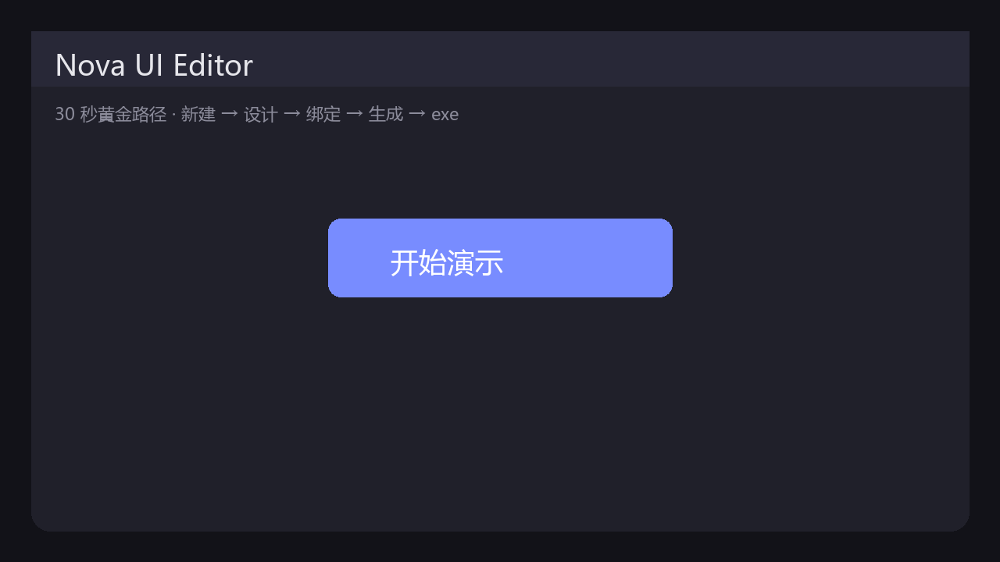
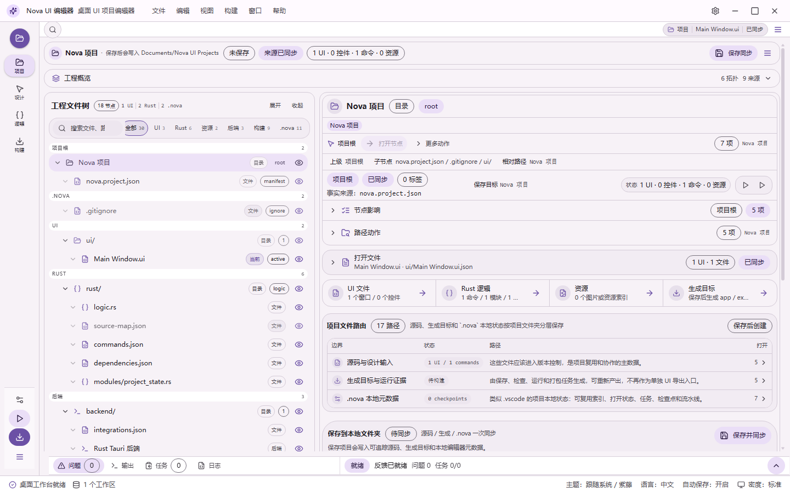
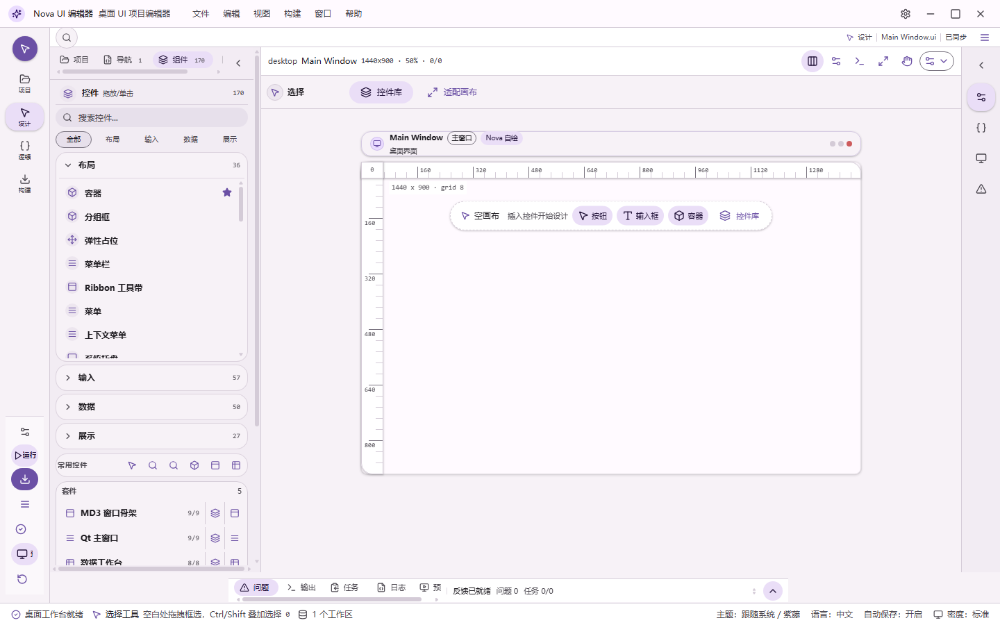
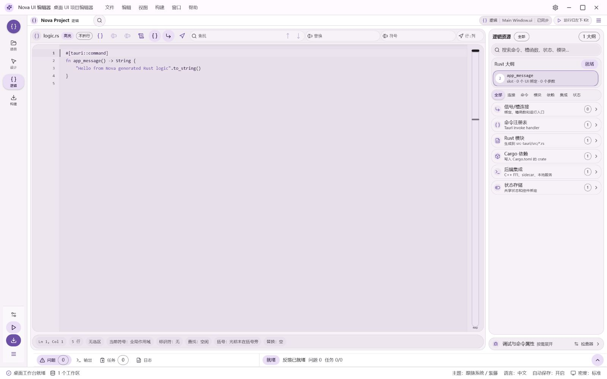
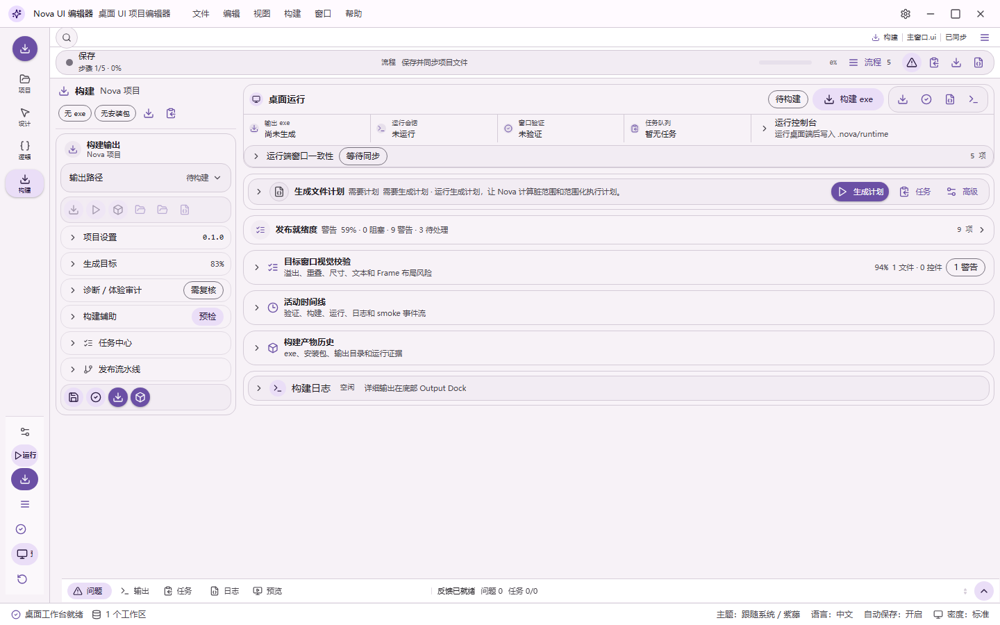

# Nova UI Kit

[](https://github.com/sorrowfeng/nova-ui-kit/actions/workflows/build.yml)
[](./LICENSE)
[](https://tauri.app/)
[](https://react.dev/)
[](https://www.typescriptlang.org/)

Nova UI Kit is a desktop-first UI editor and component workbench built with Tauri, React, TypeScript, Tailwind CSS, Radix UI, shadcn/ui-style primitives, and lucide-react.

The project started as a UI kit showcase and is evolving into **Nova UI Editor**: a lightweight Qt Creator / Qt Design Studio-inspired desktop editor for designing Tauri applications, wiring Rust commands, and building release executables from a visual project workflow.

> Status: active alpha. The editor is already usable for local experimentation, but project schemas, generated output, and editor workflows may still change quickly.

## Screenshots

Screenshots are captured from the current desktop-oriented editor UI.
Refresh locally with `npm run docs:screenshots` after UI changes.



> 30 秒黄金路径：新建 → 设计 → 绑定 → 生成 → exe。逐步图文见 [docs/golden-path.md](docs/golden-path.md)。

| Project workspace | Design canvas |
| --- | --- |
|  |  |

| Rust logic workspace | Build workspace |
| --- | --- |
|  |  |

## Why Nova

Nova is meant for building desktop application interfaces, not marketing pages. The editor is organized around an IDE-like workflow:

- Project mode for local project files, generated output, checkpoints, assets, and metadata.
- Design mode for a visual canvas, component palette, navigator, inspector, responsive breakpoints, and layout controls.
- Logic mode for Rust commands, modules, command bindings, state, diagnostics, and backend integration planning.
- Build mode for generated-file planning, readiness checks, validation, task queues, release metadata, exe builds, installer bundles, and runtime logs.

The interface intentionally favors compact desktop chrome, fine borders, dockable tool surfaces, dense lists, keyboard-friendly controls, and real interaction states.

## Highlights

- Tauri v2 desktop shell with a custom titlebar and Windows GUI release executable.
- React 18 + TypeScript frontend built with Vite.
- Tailwind CSS design tokens with light/dark theme support and density-aware UI.
- shadcn/ui-style component organization in `src/components/ui`.
- Radix UI primitives for accessible dialogs, dropdowns, popovers, selects, switches, tabs, toasts, and tooltips.
- lucide-react icons across toolbar, dock, action, and status controls.
- Visual UI editor with project files, canvas controls, frames, responsive breakpoints, property editing, undo/redo, and component insertion.
- Rust-first backend logic workflow with generated `#[tauri::command]` handlers, modules, command schemas, event bindings, state patches, diagnostics, and source mapping.
- Build workflow for generated Tauri targets, quick checks, generated-window validation, exe output, bundle artifacts, installer smoke handoff, task history, and runtime logs.
- Local project persistence through the Tauri backend, including `.nova` metadata, checkpoints, generated-file plans, and build evidence.

## Tech Stack

| Layer | Technology |
| --- | --- |
| Desktop shell | Tauri v2 |
| Native backend | Rust |
| Frontend | React 18, TypeScript, Vite |
| Styling | Tailwind CSS, CSS variables |
| UI primitives | shadcn/ui-style components, Radix UI |
| Icons | lucide-react |
| Generated app target | Tauri + React + Rust |
| CI | GitHub Actions |

## Architecture

```text
Nova UI Kit
├─ React editor shell
│  ├─ Project / Design / Logic / Build modes
│  ├─ reusable UI primitives
│  ├─ desktop docks, titlebar, toolbars, canvas, inspector
│  └─ generated target preview and editor-side validation
├─ Tauri backend
│  ├─ project persistence
│  ├─ generated file planning and writing
│  ├─ Rust command/source-map generation
│  ├─ task queue and background process registry
│  ├─ build, bundle, runtime, and installer smoke helpers
│  └─ local filesystem and artifact operations
└─ Generated Tauri app
   ├─ generated React runtime
   ├─ generated Rust commands
   ├─ assets and project data
   └─ release exe / bundle output
```

The current backend logic is mainly implemented in Rust inside `src-tauri/src`. Rust is the best-integrated backend path today because it is native to Tauri, easy to call from the frontend through commands, and already owns project persistence, generated-file writing, builds, diagnostics, and runtime process control.

Nova also includes backend integration scaffolding for non-Rust logic:

- C++ FFI or native libraries for performance-critical logic.
- Go, Python, Node, or other sidecar/local-service processes for independent services.
- Generated handoff files, resource mappings, health checks, and starter scaffolds for backend integration plans.

## Repository Structure

```text
nova-ui-kit/
├─ docs/
│  └─ screenshots/                 # README and project screenshots
├─ examples/
│  ├─ python-local-service/        # runnable Python stdio sidecar
│  └─ cpp-ffi/                     # runnable C++ extern "C" FFI sample
├─ src/
│  ├─ App.tsx
│  ├─ main.tsx
│  ├─ index.css                    # Tailwind tokens and theme variables
│  ├─ components/
│  │  ├─ ui/                       # reusable shadcn/ui-style primitives
│  │  ├─ layout/                   # desktop shell and app layout pieces
│  │  └─ showcase/
│  │     ├─ BuilderShowcase.tsx    # editor orchestration
│  │     └─ builder/               # editor domain modules
│  ├─ data/                        # demo/component metadata
│  └─ lib/                         # shared helpers such as cn()
├─ src-tauri/
│  ├─ capabilities/
│  ├─ icons/
│  ├─ src/                         # Rust backend and Tauri commands
│  ├─ Cargo.toml
│  └─ tauri.conf.json
├─ scripts/                        # validation and smoke-check scripts
├─ .github/workflows/build.yml
├─ package.json
├─ tailwind.config.ts
└─ README.md
```

## Requirements

- Node.js 22 or newer.
- npm.
- Rust stable toolchain.
- Platform prerequisites for Tauri v2 desktop development.

For Windows desktop builds, the project produces:

```text
src-tauri/target/release/nova-ui-kit.exe
```

The app is configured as a Windows GUI executable, so launching the release exe should not open a console window.

## Getting Started

Install dependencies:

```bash
npm install
```

Run the Vite frontend:

```bash
npm run dev
```

Open:

```text
http://127.0.0.1:1420
```

Run the desktop app in development:

```bash
npm run tauri:dev
```

Build the frontend:

```bash
npm run build
```

Build a release exe without creating an installer bundle:

```bash
npm run tauri:exe
```

Build the full Tauri bundle:

```bash
npm run tauri:build
```

## Scripts

| Script | Description |
| --- | --- |
| `npm run dev` | Start Vite on `127.0.0.1:1420`. |
| `npm run build` | Run component, editor-experience, size guard, TypeScript, and Vite production checks. |
| `npm run preview` | Preview the production frontend build. |
| `npm run tauri:dev` | Start the Tauri desktop dev app. |
| `npm run tauri:exe` | Build the release executable without bundling an installer. |
| `npm run tauri:build` | Build the full Tauri bundle. |
| `npm run check:components` | Verify component palette/editor/runtime coverage. |
| `npm run check:experience` | Verify editor UX contracts (includes runtime-contract, persistence, goal). |
| `npm run check:builder-runtime` | Run browser smoke checks for the editor workflow. |
| `npm run check:showcase-size` | Guard `BuilderShowcase.tsx` line-count ceiling. |
| `npm run check:runtime-contract` | Verify generated app runtime markers. |
| `npm run check:generated-runtime` | Run targeted generated-runtime Rust tests. |
| `npm run check:project-persistence` | Run project persistence Rust tests. |
| `npm run check:goal` | Verify Qt Creator parity goal coverage. |
| `npm run check:desktop-exe` | Check desktop exe artifacts. |
| `npm run release:notes` | Draft release notes from git history. |
| `npm run verify:desktop` | Run desktop release verification and exe smoke checks. |

UI text / density audits (optional, needs a local browser):

```bash
node output/ui-audit/run-ui-text-audit.mjs
node output/goal-audit/run-goal-audit.mjs
```

## Documentation

| Doc | Contents |
| --- | --- |
| [docs/architecture.md](docs/architecture.md) | Module map and where to change things |
| [docs/project-schema.md](docs/project-schema.md) | `.nova` / project schema and migration policy |
| [docs/generated-write-policy.md](docs/generated-write-policy.md) | Generated-file write / conflict policy |
| [docs/accessibility-checklist.md](docs/accessibility-checklist.md) | Manual a11y checklist |
| [docs/backend-integration.md](docs/backend-integration.md) | Sidecar / FFI backend integration |
| [docs/release-pipeline.md](docs/release-pipeline.md) | Release evidence and installer smoke |
| [docs/golden-path.md](docs/golden-path.md) | New project → design → bind → generate → exe |
| [docs/release-checklist.md](docs/release-checklist.md) | Alpha → beta pre-release checklist |
| [docs/usability-roadmap.md](docs/usability-roadmap.md) | UX / convenience improvement backlog |
| [docs/troubleshooting.md](docs/troubleshooting.md) | FAQ and environment troubleshooting |
| [docs/后续工作计划.md](docs/后续工作计划.md) | Iteration plan and progress snapshot |

## Development Workflow

Recommended local verification before opening a pull request:

```bash
npm run build
npm run check:builder-runtime
npm run verify:desktop
```

`npm run verify:desktop` is the closest current confidence check for the desktop-first workflow. It runs editor smoke checks, generated-runtime checks, Tauri exe build, and release exe validation.

The Vite build can warn about large chunks. That warning is currently expected and does not mean the build failed.

## Core Concepts

### Projects

Nova projects are local editor workspaces with UI files, assets, Rust command definitions, state variables, release settings, generated-file plans, checkpoints, and `.nova` metadata.

### Canvas

The design canvas supports freeform controls, frames, layout modes, breakpoints, grid/snap behavior, selection tools, layer management, and inspector-driven property editing.

### Logic

Logic mode is Rust-first. It manages commands, modules, Cargo dependencies, event bindings, result schemas, state patching, generated source maps, diagnostics, and backend integration planning.

### Build

Build mode coordinates generated target files, readiness checks, visual validation, quick checks, exe builds, bundle artifacts, release metadata, installer smoke handoff, runtime logs, and task history.

## Current project generation pipeline

Nova's project flow is designed around a generated Tauri application target:

```text
Project workspace
  -> UI files, assets, state, and release metadata
  -> visual canvas and component tree
  -> Rust command registry and module files
  -> event bindings and result/state patch schemas
  -> generated file plan with disk diff status
  -> readiness checks and generated-window validation
  -> generated React runtime and Tauri project files
  -> frontend/Rust quick checks
  -> Tauri release executable or installer bundle
```

This keeps the editor, generated source files, validation artifacts, build logs, and release output connected as one desktop application workflow.

## Adding Components

To add a new draggable component:

1. Add the component type to `BuilderComponentType` (`src/components/showcase/builder/types-canvas.ts`).
2. Add a palette entry and default props (`BuilderShowcase.tsx` palette table).
3. Add editor preview rendering (`BuilderShowcase.tsx` `renderBuilderPreview`).
4. Add generated-app rendering (`src-tauri/src/generated_templates/app_tsx.rs`).
5. Add inspector controls for editable props (`InspectorDock.tsx` / property schema).
6. Add event binding support if the component emits actions (`builder/event-bindings.ts`).
7. Add or update coverage checks so the component appears in palette, editor, and runtime surfaces (`npm run check:components`).

Checklist for new components:

- [ ] Type union + palette + preview + runtime branch all updated
- [ ] Default props render without text clip at 1440 and 1100 viewports
- [ ] Icon button / interactive control has accessible name
- [ ] `npm run check:components` and `npm run build` pass

See `docs/architecture.md` for the module map.

## Roadmap

- Continue extracting editor modules from `BuilderShowcase.tsx` (canvas marquee/resize hooks, mode workspaces).
- Make generated component code richer (fuller props / events / slots schemas).
- Ship a runnable non-Rust backend sample (Python local-service / C++ FFI) end to end.
- Deeper generated-app template customization points.
- Further bundle splitting of the editor main chunk.
- Finish remaining a11y manual pass items from `docs/accessibility-checklist.md`.
- Expand multi-platform installer verification matrix and CI release notes.

## Contributing

Contributions are welcome while the project is in alpha. Good first areas:

- Small UI polish and accessibility improvements.
- Editor workflow smoke tests.
- Component palette coverage.
- Documentation and screenshots.
- Rust backend refactors with focused tests.

Before sending a pull request:

1. Keep changes scoped and easy to review.
2. Prefer existing tokens, components, and layout patterns.
3. Run the relevant checks from the Scripts section.
4. Include screenshots or short videos for visible UI changes.

## Security

Please do not open public issues for sensitive security reports. If you find a vulnerability, contact the maintainer privately or use GitHub's private vulnerability reporting if it is enabled for the repository.

## License

Nova UI Kit is released under the MIT License. See [LICENSE](./LICENSE).
